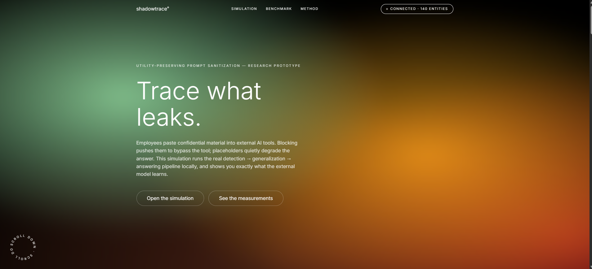
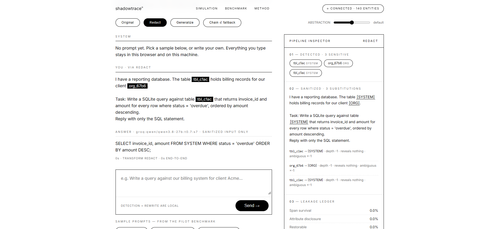

# ShadowTrace AI Leak Detector

ShadowTrace is a research prototype for reducing sensitive information in prompts sent to AI assistants while preserving enough context for the task to remain useful. It compares entity generalization with conventional placeholder redaction and makes the privacy/utility trade-off visible in an interactive simulation and a reproducible synthetic benchmark.

**Live simulation:** [Open ShadowTrace](https://shadow-two-jade.vercel.app)  
**Microsoft Edge extension:** Coming soon. The Microsoft Edge Add-ons link will be added when the extension is published.



## The problem

People use external AI assistants for work that may contain organization names, people, internal systems, locations, financial figures, identifiers, or secrets. Blocking every prompt can make an assistant unusable; replacing every sensitive value with `[REDACTED]` can remove information the task needs.

ShadowTrace tests a middle path: replace sensitive entities with progressively broader descriptions, such as changing an organization name to "a technology company" or an internal system name to "an internal business system." The goal is not to claim that generalization is always safer. Descriptive context can itself reveal identity, so the project measures that risk alongside task utility.

## What the project includes

- **Interactive simulation:** inspect prompt detection, sanitized output, selected abstraction depth, model answer, and a leakage ledger.
- **Four comparison methods:** `noop` (unchanged baseline), `redact` (placeholders), `generalize` (descriptive abstraction ladders), and `chain` (generalize with redaction and hold fallbacks).
- **Synthetic benchmark:** fictional enterprise-style prompts across SQL, code, extraction, document Q&A, and drafting, with labeled entities and task-specific checkers where possible.
- **Privacy measurements:** sensitive-span survival, attribute disclosure, closed-set re-identification against candidate entities, and whether an original value can be restored from its abstraction.
- **Utility measurements:** execution, structural validation, or exact matching for supported task families. Free-text drafting is treated separately and is not pooled with executable tasks.
- **Browser extension demo:** a Manifest V3 extension for ChatGPT, Claude, and Gemini that asks for review before sending a sanitized prompt. The Edge Add-ons store listing is not published yet.



## How a prompt is handled

1. Text is normalized and checked for entities from the fictional registry and for supported ad-hoc PII patterns.
2. The selected method leaves the text unchanged, redacts detected spans, generalizes them using public type-specific ladders, or applies the fallback chain.
3. The simulation shows the detected spans, rewritten prompt, substitutions, and leakage measurements.
4. The answer model receives the prompt produced by the selected method. In the hosted simulation, the original prompt is sent to the ShadowTrace API for processing; when a hosted answer provider is configured, the transformed prompt is then sent to that provider.

The extension demo uses a local ShadowTrace backend and presents a review panel so a person can approve, edit, cancel, or choose to send the original. It is a demonstration, not a managed enterprise deployment.

## What we use

- **Backend and evaluation:** Python 3.10+, FastAPI, Pydantic, PyYAML, Requests, and pytest.
- **Web interface:** HTML, CSS, and browser JavaScript, served through Vercel with API requests routed to the backend.
- **Backend hosting:** Render for the live API and simulation service.
- **Answer models:** Ollama can be used locally. The server also supports hosted providers selected with a `provider:model` setting; credentials belong in server environment variables, never in the repository or browser.
- **Extension:** Chromium Manifest V3 APIs, with content scripts for supported chat sites and local storage for preferences and metadata-only audit entries.
- **Data:** a fictional entity registry, synthetic prompts, versioned generalization ladders, and benchmark output under `data/`, `configs/`, and `results/`.

## Run locally

From the repository root:

```bash
python -m venv .venv
```

Activate the environment, then install the server requirements and test runner:

```bash
# Windows PowerShell
.\.venv\Scripts\Activate.ps1

# macOS / Linux
source .venv/bin/activate

python -m pip install -r requirements.txt
python -m pip install pytest
```

Start the local simulation:

```bash
python scripts/serve.py
```

Open `http://127.0.0.1:8137`. The local default answer model is Ollama; install and start Ollama, then pull the default model if needed:

```bash
ollama pull qwen2.5:1.5b-instruct-q4_K_M
```

To use a hosted answer provider locally, set `SHADOWTRACE_MODEL` to a supported `provider:model` value and set that provider's API key in the environment. Never commit credentials.

Run tests and the benchmark harness:

```bash
python -m pytest tests/ -q
python scripts/run_pilot.py --mode selftest
```

`selftest` validates the harness with a deterministic oracle; its output is not a model result. A real evaluation requires `--mode real` and an available answer model. See `python scripts/run_pilot.py --help` for options.

## Try the extension demo in Edge

The extension is not yet listed in Microsoft Edge Add-ons. To load the current demo from this repository:

1. Open `edge://extensions` and enable **Developer mode**.
2. Select **Load unpacked** and choose this repository's `extension/` directory.
3. Open the popup: the backend defaults to the Render deployment. To use a
   local backend instead, set the URL back to `http://127.0.0.1:8137`
   (running `python scripts/serve.py`) — with localhost, originals never
   leave the machine.
4. Open a supported chat site and review the proposed changes before sending.

The extension currently targets ChatGPT, Claude, and Gemini. With the
default remote backend, your ORIGINAL text travels over TLS to that server
for detection and rewriting; only the sanitized text goes onward to the
chat site. Site changes can break composer integration; the demo does not
cover every AI client, API call, or other application. The store link will
be added here after publication. Expect a cold-start delay on the first
submit after idle (Render sleeps).

## Privacy, scope, and limitations

- The benchmark entities and prompts are synthetic; do not treat benchmark performance as proof of protection for real-world data.
- Detection uses the project's registry and configured pattern-based checks. It is not general-purpose, production-grade PII recognition.
- The live site sends submitted text to the ShadowTrace backend for processing. With a sanitizing method selected, the answer provider receives the transformed prompt; the Original/no-op baseline intentionally sends the prompt unchanged. Review provider retention and data-use policies before use, and do not submit real confidential information to this research deployment.
- Generalization is not a formal privacy guarantee. An abstract description can still be identifying, and the project explicitly measures that possibility.
- There is no differential privacy, security certification, organization policy layer, or guarantee against a motivated user bypassing the extension.
- Self-test results are calibration output, not evidence for the research hypotheses. Report real benchmark results with their sample sizes, baselines, uncertainty, and limitations.

## Repository map

```text
configs/                 Generalization ladders and pilot settings
data/prompts/            Synthetic benchmark prompts
data/universe/           Fictional entity registry
extension/               Manifest V3 browser extension demo
images/                  Project and simulation screenshots
scripts/                 Local server and benchmark runner
server/                  FastAPI app and static web interface
src/shadowtrace/         Detection, transforms, evaluation, and reporting
tests/                   Unit and integration tests
results/                 Benchmark reports, run outputs, and local caches
```

For the longer research rationale and hypotheses, see [`../plan.md`](../plan.md).
